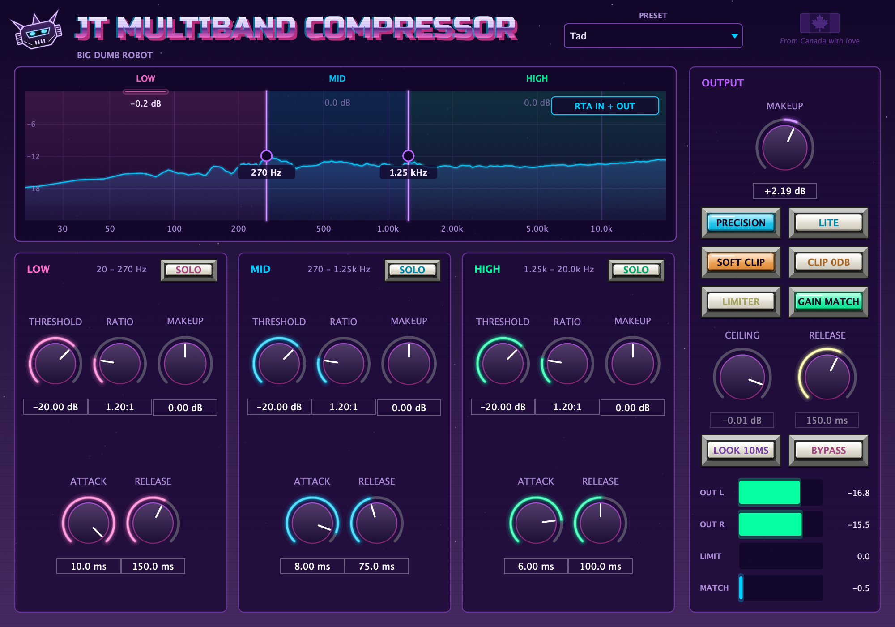

# JT Multiband Compressor

A free three-band multiband compressor by **Big Dumb Robot**. VST3, AU and AAX (macOS), built with JUCE.



## Install

Download **JT-Multiband-Compressor-<version>.pkg** from the
[latest release](https://github.com/BigDumbRobot/jt-multiband-compressor/releases/latest) and open it.
It installs the VST3 and Audio Unit for all users (Apple silicon and Intel, macOS 11+) into
`/Library/Audio/Plug-Ins/VST3` and `/Library/Audio/Plug-Ins/Components`, and asks for your
administrator password.

The installer isn't signed with an Apple Developer ID yet, so macOS warns the first time you open it.
Right-click the .pkg and choose **Open**, or go to **System Settings > Privacy & Security** and click
**Open Anyway**.

To uninstall, delete `JT Multiband Compressor.vst3` and `JT Multiband Compressor.component` from those
two folders.

## What it does

The signal path, per block:

1. **Crossover.** Three bands from two elliptic lowpasses in cascade (0.3 dB ripple, 30 dB stopband).
   The order is chosen per crossover frequency. Each lowpass runs block-wise forwards and backwards,
   so the band split is close to zero-phase, and the bands always sum back to the input.
2. **Band compressors.** Feed-forward, hard knee, with lookahead (2 ms, or 10 ms with LOOK 10MS).
   The level detector mixes a 0.8 ms power average with the peak. Each band has threshold, ratio,
   attack, release and makeup, plus Solo.
3. **Sum and makeup.**
4. **Soft clip** (optional). A cubic-knee saturator, or a variant that holds unity gain up to a hard
   0 dBFS ceiling (CLIP 0DB).
5. **Limiter** (optional). A brickwall lookahead peak limiter with a linked stereo detector,
   a linear attack ramp, hold, then release.
6. **Gain Match** (optional). Measures input and output loudness (ITU-R BS.1770 K-weighting,
   3 s window) and matches the output to the input. It remembers its gain between plays, so there is
   no level jump when you press play.

### Engines

| Mode | What runs | CPU (one instance, stereo 48 kHz, Apple silicon) |
|---|---|---|
| Classic | The chain at the session rate | ~1% |
| Precision | The whole chain at 32x oversampling, between a 2x + 16x Kaiser-windowed polyphase converter, in double precision | ~18–23% |
| Precision Lite | The same 32x chain with lighter arithmetic: an FFT first converter stage, single-precision converters, fused multiply-adds and SIMD in the chain. It nulls against Precision at -80 to -126 dB | ~8–12% |

The chain always runs on fixed 512-sample blocks through a FIFO, so the sound and the latency don't
depend on the DAW's buffer size.

### Display

The frequency display shows the crossover points (drag them), each band's gain reduction, and a
real-time analyser of the input and output (click the label to cycle IN / OUT / IN + OUT / off).

### Presets

- **Default**: everything neutral.
- **Tad**: gentle glue: all bands -20 dB at 1.2:1, +2.19 dB makeup, soft clip, Gain Match, Precision.

## Building

Needs CMake 3.22+ and Xcode command-line tools (macOS 11+). JUCE 9.0.5 is downloaded at configure time.

```sh
cmake -B build -G Ninja -DCMAKE_BUILD_TYPE=Release        # -DBDR_AAX=OFF to skip AAX
cmake --build build --target JTMultibandCompressor_VST3 JTMultibandCompressor_AU
```

To use a local JUCE checkout instead of downloading one, add `-DFETCHCONTENT_SOURCE_DIR_JUCE=/path/to/JUCE`.

AAX builds unsigned; it loads in Pro Tools Developer, and needs signing for regular Pro Tools.

### Installer

`packaging/build_pkg.sh` builds the universal installer into `dist/`. With an Apple Developer account it
also signs and notarizes: set `DEV_ID_APP`, `DEV_ID_INSTALLER` and `NOTARY_PROFILE` (see the script).

### Tools

- `JTRender icon.png screenshot.png [preset]`: renders the plugin icon and an editor screenshot.
- `JTXoverCheck`: prints a crossover design (`JTXoverCheck <fc> <fs>`), compares the
  crossover at different internal rates (`ratecmp`), and benchmarks the engines
  (`bench [seconds]`, `LITE=1` for Precision Lite, `NOCLIP` / `NOLIMIT` to drop stages).

The Precision arithmetic is deliberately unfused (`-ffp-contract=off`) and in a fixed operation order,
so its results are reproducible to the last bit.

## License

Free and open source under the [Apache License 2.0](LICENSE). Copyright 2026 Big Dumb Robot.

Built with [JUCE](https://juce.com), which has its own licence (AGPLv3, or a commercial JUCE licence):
binaries built from this source include JUCE. See [NOTICE](NOTICE).

The title font is Russo One (SIL Open Font License, `assets/fonts/RussoOne-OFL.txt`).

From Canada with love.
